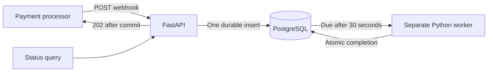

# Transaction Webhook Service

Python implementation of the Confluencr backend assessment: acknowledge transaction webhooks quickly, wait 30 seconds, and reliably store one processed transaction per ID.

## Run locally

Prerequisite: Docker with Compose. No cloud account or API keys are needed.

```bash
docker compose up -d --build
docker compose ps
curl http://localhost:8000/
```

Compose starts PostgreSQL, runs the versioned migration once, then starts the API and an independent worker. The API and PostgreSQL ports are bound to localhost. PostgreSQL data survives container restarts in a named volume.

Open **http://localhost:8000/docs** for the interactive API tester. The assignment specifies backend endpoints; Swagger UI supplies a convenient testing interface.

Stop the service with `docker compose down`. This preserves transactions. Running `docker compose down -v` also deletes this project's database volume, so use it only when you want to reset the local data.

## Try a transaction

```bash
curl -i http://localhost:8000/v1/webhooks/transactions \
  -H 'Content-Type: application/json' \
  -d '{
    "transaction_id": "txn_abc123def456",
    "source_account": "acc_user_789",
    "destination_account": "acc_merchant_456",
    "amount": 1500,
    "currency": "INR"
  }'

curl http://localhost:8000/v1/transactions/txn_abc123def456
```

The POST returns **202 Accepted** and `{"status":"ACCEPTED"}` after the database commits. Initially, the query returns:

```json
[
  {
    "transaction_id": "txn_abc123def456",
    "source_account": "acc_user_789",
    "destination_account": "acc_merchant_456",
    "amount": 1500.0000,
    "currency": "INR",
    "status": "PROCESSING",
    "created_at": "2026-10-30T09:00:00Z",
    "processed_at": null
  }
]
```

Query again after approximately 30 seconds: status becomes `PROCESSED`, with a UTC `processed_at` timestamp. Timestamps above are illustrative. Repeating the POST, even after completion, returns 202 and retains the original data and timestamps.

## API contract

| Route | Result |
| --- | --- |
| `GET /` | 200 with `status: HEALTHY` and current UTC time; 503 if storage/schema is unavailable |
| `POST /v1/webhooks/transactions` | 202 once durably stored; duplicate IDs also return 202 |
| `GET /v1/transactions/{transaction_id}` | 200 with the PDF's single-element array; 404 for unknown IDs |
| `GET /docs`, `GET /openapi.json` | Interactive tester and machine-readable contract |

Validation returns 422 for missing/extra fields, invalid JSON, invalid identifiers, non-positive amounts, strings/booleans/non-finite amounts, more than four decimal places, or invalid currency format. IDs accept 1–128 ASCII letters, digits, underscores or hyphens. Currency accepts three uppercase letters; the assessment does not specify a currency allowlist. Amounts use `NUMERIC(20,4)` (up to 16 integer and 4 fractional digits), with exact Decimal parsing and numeric JSON output. The body limit is 16 KiB, including chunked requests (413 if exceeded).

**Idempotency policy:** the first valid payload for a `transaction_id` wins. Later deliveries with that ID are acknowledged and ignored, including deliveries with different fields. A primary key enforces this across concurrent API instances. Deduplication records are retained indefinitely.

**Storage failures:** return 503 with `Retry-After: 1`; the sender should retry with the same ID. If a connection fails during commit, the outcome can be uncertain, and that same-ID retry safely resolves either outcome. No 202 is deliberately returned before persistence succeeds.

## Why these choices



- **FastAPI and async Psycopg pools:** short database operations on the request path, validation, generated API documentation, and bounded connections. The 30-second delay never occupies an API worker.
- **One PostgreSQL row is both transaction and queue entry:** inserting the transaction durably schedules the job in the same statement. There is no database/broker dual write. `DATABASE_URL` can point at managed cloud PostgreSQL when deployment is chosen.
- **Durable 30-second delay:** PostgreSQL sets `ready_at = created_at + 30 seconds`. Workers only complete rows whose deadline has passed. Persisting the timer avoids sleeping while holding a task or connection, survives process restarts, and allows many transactions to wait concurrently. The simulation consists of the required delay followed by the persisted completion; no payment is moved and no external API is called.
- **Atomic completion:** workers claim due rows with `FOR UPDATE SKIP LOCKED` and update the result in the same short transaction. Several workers can run concurrently. A crash before commit rolls back; a crash after commit leaves a processed row that will not be selected again. Database constraints disallow early completion or inconsistent status/timestamps.
- **Retry without loss:** a transient worker error rolls back the batch and retries with exponential backoff up to 10 seconds. No job is silently discarded after a retry limit. API and worker processes restart independently. Pending jobs resume when a worker returns; overdue jobs process immediately.
- **Small operational footprint:** one database, one API, one worker; no Redis, Celery, or extra managed queue needed for this simulated workload. Migrations are ordered, checksummed, serialized and transactional.

The exactly-once guarantee applies to the committed database result in this simulation. Adding real payment-provider side effects requires provider-supported idempotency and a durable record of external outcomes; a local database transaction alone cannot guarantee exactly-once external effects.

See the underlying [PostgreSQL row-locking documentation](https://www.postgresql.org/docs/17/sql-select.html#SQL-FOR-UPDATE-SHARE), [Psycopg pool documentation](https://www.psycopg.org/psycopg3/docs/advanced/pool.html), and [FastAPI documentation](https://fastapi.tiangolo.com/).

## Test

Install [uv](https://docs.astral.sh/uv/getting-started/installation/) for local Python development. It uses the committed Python version and lockfile.

```bash
docker compose up -d db
uv sync --frozen
uv run ruff check .
uv run ruff format --check .
uv run pytest -q -s
```

Tests use real PostgreSQL, create a random schema per case, and delete only their own schemas. Set `TEST_DATABASE_URL` to a separate PostgreSQL database if needed; the test role needs schema creation privileges. Tests never truncate the running application's tables.

The suite includes a real 30-second test with 200 unique transactions and concurrency 20, simultaneous duplicate delivery, multiple worker pools, pool restart recovery, failed processing rollback/retry, worker backoff, storage errors/timeouts, exact money round trips, and request validation. Most tests move test-only receipt/deadline timestamps into the past for speed; the `slow` test uses the unmodified real delay. `uv run pytest -m 'not slow'` runs the quick subset.

To verify the Docker service through actual HTTP, including load and the full delay:

```bash
uv run python scripts/verify_http.py --output work/http-verification.json
```

This sends 200 unique transactions, 20 duplicate deliveries while pending and one after completion; checks all acknowledgments are below 500ms; and queries every final result. It leaves the test transactions in the local application database for inspection. `.github/workflows/ci.yml` runs lint, formatting, all database tests and an image build on push/PR once a repository is published.

An additional recovery check is available for this local Compose stack:

```bash
uv run python scripts/verify_recovery.py --output work/recovery-verification.json
```

Run it separately from other tests: it kills the local worker and stops/restarts this project's API/database to verify that accepted work survives, database outages return a fast 503, and retried deliveries finish once storage recovers. It preserves the database volume and restarts the services afterward.

## Run Python processes directly

```bash
docker compose up -d db
uv sync --frozen
cp .env.example .env
uv run python -m app.migrate
uv run uvicorn app.main:app --host 127.0.0.1 --port 8000
```

In a second terminal from this directory:

```bash
uv run python -m app.worker
```

Stop the Compose API/worker first if they are already running, to avoid a port conflict or an extra worker during debugging: `docker compose stop api worker`.

## Configuration and limits

| Variable | Default | Purpose |
| --- | --- | --- |
| `DATABASE_URL` | Local PostgreSQL on port 55432 | Set for every process; use the cloud provider's required TLS parameters later |
| `POOL_MIN_SIZE` / `POOL_MAX_SIZE` | 2 / 10 | Connections per API or worker process |
| `REQUEST_TIMEOUT_SECONDS` | 0.45 | Maximum database-operation budget on the request path; configurable downward only |
| `WORKER_POLL_SECONDS` | 0.1 | Idle polling interval |
| `WORKER_BATCH_SIZE` | 100 | Maximum completions per short database transaction |
| `LOG_LEVEL` | INFO | Worker logging verbosity |

The delay is fixed at 30 seconds in the database schema. SQL statements have a 350ms limit and lock waits a 100ms limit. The API bounds storage work to 450ms; serialization, host scheduling, network latency, and extreme overload can still affect observed end-to-end latency. The local load test measures the stated workload; it is not an unlimited-load or cloud-latency guarantee. Saturation/storage failures return retryable 503 rather than accepting transactions without persistence. Monitor pending-row count/oldest `ready_at` and worker error logs when operating the service.

The assessment endpoints are unauthenticated. Before using a real payment source, its signature contract and credentials must be configured. Local credentials are intentionally development-only; secrets belong in environment configuration and `.env` is ignored. Logs contain counts/error types rather than account payloads or connection strings.

## Deployment status

The application source is published in this GitHub repository. No cloud service or public API endpoint is deployed. The image supports separate API and worker processes against managed PostgreSQL; the hosting target, cloud database and production secrets remain to be selected.

## Verified locally on 30 October 2026

- 31 PostgreSQL-backed tests passed, including a real 30-second test.
- Actual HTTP load: 200 unique transactions, 21 duplicate deliveries, concurrency 20; acknowledgment p50 29.751ms, p95 111.657ms, maximum 171.449ms. All results completed after 30.003–30.117 seconds.
- Worker SIGKILL, API restart and database stop/start recovery passed. An attempted delivery during the database outage returned 503 in 3.483ms; its retry completed after recovery.
- Lint, formatting, lock consistency, container build, OpenAPI and Swagger tester checks passed.
- Machine-readable results and PDF inspection evidence are in `reports/`. CI is configured but has not run on GitHub because the repository has not been published.
